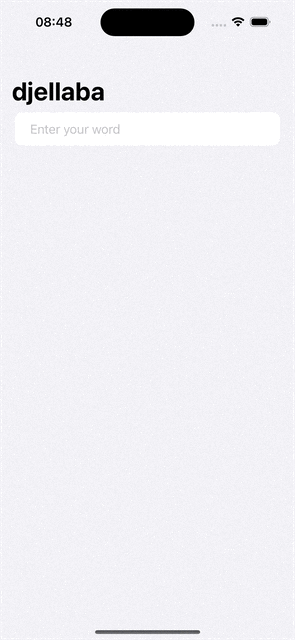

# WordScramble
Paul Hudson's 100 Days of SwiftUI Project 5.

## Accessibility support added

Paul added the `.accessibility...` code to the HStack below. `.accessibilityElement` groups the whole stack together. `.accessibilityLabel` makes VoiceOver read the word, and `.accessibilityHint` reads how many letters the word has. These changes make it possible for people with disabilities to play the game. If those changes weren't present, it would make it a very bad experience, i.e. VoiceObver would try to describe the image, which would add confusion to the context.

```swift
var body: some View {
        NavigationStack {
            List {
                Section {
                    TextField("Enter your word", text: $newWord)
                        .textInputAutocapitalization(.never)
                }
                
                Section {
                    ForEach(usedWords, id: \.self) { word in
                        HStack {
                            Image(systemName: "\(word.count).circle")
                            Text(word)
                        }
                        .accessibilityElement()
                        .accessibilityLabel(word)
                        .accessibilityHint("\(word.count) letters")
                    }
                }
            }
            .navigationTitle(rootWord)
            .onSubmit(addNewWord)
            .onAppear(perform: startGame)
            .alert(errorTitle, isPresented: $showingError) {
                Button("OK") {}
            } message: {
                Text(errorMessage)
            }
        }
    }
```

Although it can only be experienced in a real device with VoiceOver turned on, here's the the working app:



## Acknowledgments

Original code created by: [Paul Hudson - @twostraws](https://x.com/twostraws) (Thank you!)

Made with :heart: by [@cewitte](https://x.com/cewitte)
